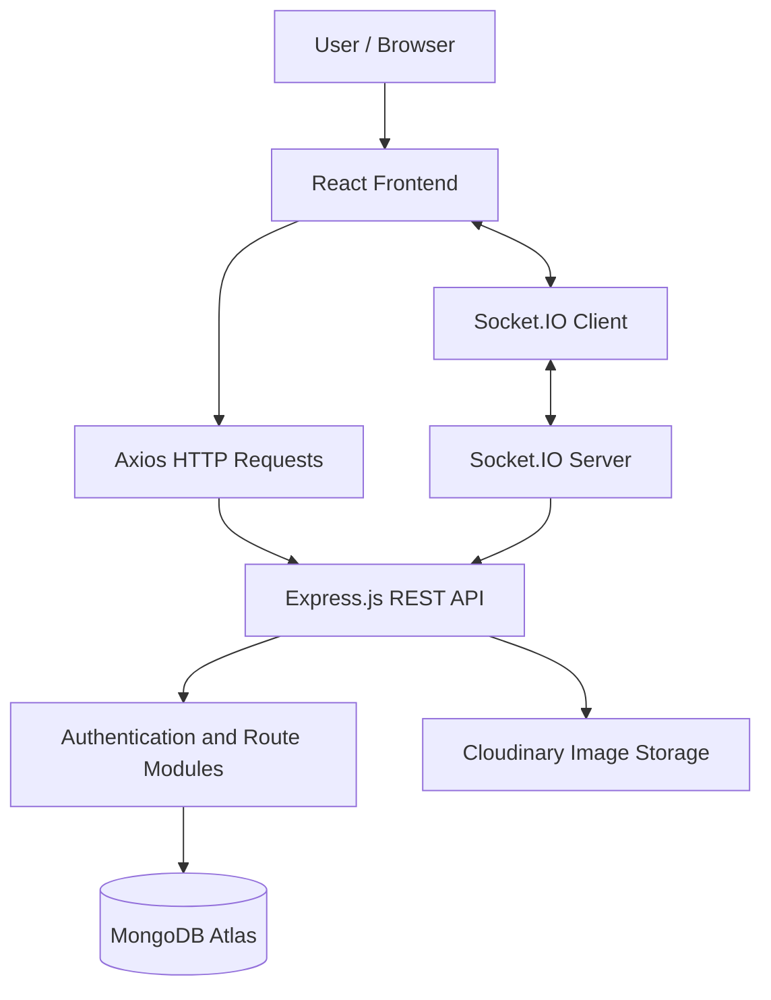

# 🌍 MyOneMile — Community-Driven Civic Engagement Platform

<p align="center">
  <strong>Your Community. Your Voice. One Mile at a Time.</strong>
  <br />
  A full-stack civic engagement platform that empowers citizens to report local issues, participate in community discussions, and bring visibility to problems that matter.
</p>

<p align="center">
  <a href="https://myonemile.vercel.app/">
    
  </a>
  <a href="https://github.com/chanchal-barak/MyOneMile">
    
  </a>
</p>

<p align="center">
  
  
  
  
  
  
</p>

---

## 📌 Project Overview

**MyOneMile** is a full-stack civic engagement web application designed to connect people with the issues affecting their local communities.

From road damage and waste management to other civic concerns, the platform provides a centralized space where users can report problems, share information, discuss community concerns, and compare issues.

The project combines a React-based frontend with a Node.js and Express backend, MongoDB for persistent data storage, and Socket.IO for real-time communication.

### 🎯 Problem Statement

Local civic issues can go unnoticed when residents lack an accessible way to report concerns, share information, and bring community attention to them.

### 💡 Our Approach

MyOneMile aims to make civic participation more accessible by bringing issue reporting, community interaction, discussions, and issue comparison together in one platform.

### 🌟 Project Highlights

- Full-stack web application with a React frontend and REST API backend.
- MongoDB integration for application data.
- JWT-based authentication.
- Civic issue reporting with image-upload support.
- Community interactions, discussions, polls, and issue comparison.
- Real-time communication using Socket.IO.
- Cloudinary integration for image storage.
- Separate frontend and backend deployments.

---

## ✨ Features

| Feature | Description |
|---|---|
| 🔐 User Authentication | Registration and login functionality with JWT-based authentication. |
| 👤 User Profiles | User-related functionality for managing profile information. |
| 📍 Issue Reporting | Create and share civic issues with relevant descriptions and images. |
| 🗳️ Community Engagement | Support community participation through voting and interaction features. |
| 💬 Discussions | Enable conversations around civic issues and community concerns. |
| ⚖️ Issue Comparison | Compare issues through a dedicated comparison feature. |
| 📊 Polls | Support community polls and participation. |
| 🏘️ Area-Based Functionality | Organize functionality related to local areas and civic concerns. |
| 📢 Reports and Spotlights | Dedicated backend modules for reports and highlighted community content. |
| 📰 Stories | Support community stories through a dedicated backend module. |
| ⚡ Real-Time Communication | Socket.IO integration for real-time application events. |
| 🖼️ Image Uploads | Cloudinary integration for cloud-based image storage. |

---

## 🛠️ Tech Stack

### Frontend

- **React.js** — Component-based user interface.
- **Vite** — Development server and build tooling.
- **Tailwind CSS** — Utility-first styling.
- **Framer Motion** — UI animations and transitions.
- **Axios** — HTTP requests to backend APIs.
- **Socket.IO Client** — Real-time client-server communication.

### Backend

- **Node.js** — JavaScript runtime.
- **Express.js** — HTTP server and REST API framework.
- **MongoDB** — NoSQL database.
- **Mongoose** — MongoDB object modeling.
- **JWT** — Authentication tokens.
- **Socket.IO** — Real-time bidirectional communication.
- **Multer** — Multipart file handling.
- **Cloudinary** — Cloud-based image storage.
- **dotenv** — Environment-based configuration.

### Cloud and Deployment

- **Vercel** — Frontend hosting.
- **Render** — Backend hosting.
- **MongoDB Atlas** — Managed database deployment.
- **Cloudinary** — Image asset storage.

---

## 🏗️ System Architecture



### Request Flow

1. Users interact with the React frontend.
2. Axios sends HTTP requests to the Express backend.
3. Backend route modules handle authentication and application functionality.
4. Mongoose communicates with MongoDB for database operations.
5. Cloudinary handles supported image-storage operations.
6. Socket.IO provides real-time communication between connected clients and the server.

---

## 📂 Backend API Structure

The backend is organized into separate route modules, keeping application functionality modular and easier to maintain.

| Route Prefix | Responsibility |
|---|---|
| `/api/auth` | Registration and authentication |
| `/api/issues` | Civic issue functionality |
| `/api/community` | Community-related functionality |
| `/api/discussions` | Discussion functionality |
| `/api/polls` | Poll-related functionality |
| `/api/compare` | Issue comparison |
| `/api/areas` | Area-related functionality |
| `/api/user` | User-related functionality |
| `/api/reports` | Reports |
| `/api/spotlights` | Spotlight content |
| `/api/stories` | Community stories |

The exact endpoints, request payloads, and response schemas are defined in the corresponding backend route and controller files.

---

## 🚀 Live Deployment

| Component | Platform | Link |
|---|---|---|
| Frontend | Vercel | [Open MyOneMile](https://myonemile.vercel.app/) |
| Backend API | Render | [Open API](https://myonemile.onrender.com/) |
| Source Code | GitHub | [View Repository](https://github.com/chanchal-barak/MyOneMile) |
| Database | MongoDB Atlas | Managed database; credentials are private |
| Image Storage | Cloudinary | Configured cloud storage integration |

**Backend health check:** Visit [myonemile.onrender.com](https://myonemile.onrender.com/) to check the API's root response.

> Note: Render's free services may take time to wake up after inactivity. Some API requests may also require authentication or application-specific data.

---

## 💻 Getting Started Locally

Follow these steps to run the project on your machine.

### Prerequisites

Install the following:

- Node.js and npm
- Git
- A MongoDB Atlas account or local MongoDB instance
- A Cloudinary account if you want to use image uploads

### 1. Clone the Repository

```bash
git clone https://github.com/chanchal-barak/MyOneMile.git
cd MyOneMile
```

### 2. Install Dependencies

Install dependencies in the frontend and backend directories separately if the repository has separate application folders.

```bash
cd backend
npm install
```

Then open another terminal:

```bash
cd frontend
npm install
```

> Adjust the directory names if your repository uses different names. Run `npm install` in the directory containing the relevant `package.json`.

### 3. Configure Environment Variables

Create a `.env` file in the backend directory and add the configuration required by your application.

Example:

```env
PORT=4000
MONGO_URI=your_mongodb_connection_string
JWT_SECRET=your_secure_jwt_secret

CLOUDINARY_CLOUD_NAME=your_cloudinary_cloud_name
CLOUDINARY_API_KEY=your_cloudinary_api_key
CLOUDINARY_API_SECRET=your_cloudinary_api_secret
```

**Important:** Use the exact environment variable names expected by your backend code. Do not commit real credentials or secrets to GitHub.

### 4. Start the Backend

From the backend directory, run the script defined in its `package.json`. For example:

```bash
npm start
```

If your project uses a different script, use the appropriate command from `package.json`.

### 5. Start the Frontend

From the frontend directory:

```bash
npm run dev
```

Open the local URL printed in your terminal by Vite.

### 6. Verify the Connection

Confirm that:

- The backend starts without database connection errors.
- The frontend can reach the backend API.
- The frontend's API base URL points to your local backend during local development.
- MongoDB Atlas permits connections from your development environment.

---

## 🔐 Environment and Security

For local development, keep secrets in a local `.env` file. For production, configure them in your hosting provider's environment settings.

Recommended practices:

- Never commit MongoDB connection strings containing credentials.
- Use a strong JWT secret.
- Restrict MongoDB network access and database-user permissions.
- Configure CORS to allow the intended frontend origins.
- Validate and sanitize incoming user input.
- Protect private routes and sensitive operations with appropriate authentication and authorization.
- Keep API keys and cloud credentials out of frontend code.

---

## 🧠 Engineering Concepts Demonstrated

MyOneMile brings together several practical full-stack engineering concepts:

- **Full-stack development:** Integrating a React frontend with a Node.js backend.
- **REST API design:** Separating application functionality into route modules.
- **Database integration:** Working with MongoDB and Mongoose.
- **Authentication:** Using JWT-based authentication.
- **Cloud integration:** Connecting managed database and image-storage services.
- **Real-time systems:** Integrating Socket.IO into a web application.
- **Deployment:** Hosting frontend and backend services independently.
- **Configuration management:** Using environment variables for local and production settings.

---

## 🔮 Future Improvements

Potential improvements include:

- Automated testing for API routes and frontend workflows.
- API documentation using Swagger/OpenAPI.
- More granular role-based authorization.
- Improved observability, structured logging, and error monitoring.
- Enhanced issue filtering and area-based discovery.
- Performance optimization and database query tuning.
- Continuous integration and automated deployment checks.

---

## 🤝 Contributing

Contributions, suggestions, and bug reports are welcome.

1. Fork this repository.
2. Create a feature branch.
3. Implement and test your changes.
4. Commit your changes with a clear message.
5. Open a pull request describing the changes.

---

## 👨‍💻 Author

**Chanchal Barak**

- GitHub: [@chanchal-barak](https://github.com/chanchal-barak)
- Project Repository: [MyOneMile](https://github.com/chanchal-barak/MyOneMile)
- Live Application: [myonemile.vercel.app](https://myonemile.vercel.app/)

---

<p align="center">
  <strong>🌍 MyOneMile</strong>
  <br />
  Your Community. Your Voice. One Mile at a Time.
</p>
